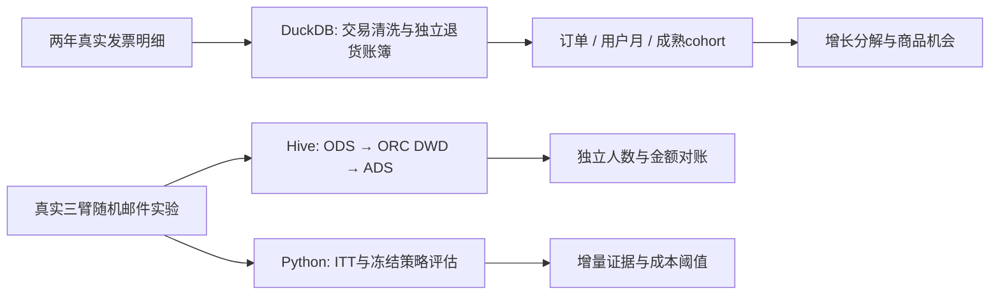

# 电商用户增长与增量营销研究

用真实交易建立购买增长指标，用真实随机实验评估营销增量，再检验有限预算下的定向策略。针对电商增长分析岗位的独立研究作品，所有数字来自可复现计算。

**先读结果：**64,000人三臂RCT中，男装/女装内容邮件相对不触达，14天购买率分别增加 **0.681、0.311个百分点**，Holm校正后显著。冻结的定向策略相对等触达随机策略，测试集增量收入差为 **−$0.006/人，95% CI [−$0.279, $0.267]**。现有证据不足以推荐用复杂模型替代简单触达。

|研究|真实数据|完成的工作|直接查看|
|---|---|---|---|
|购买增长诊断|UCI Online Retail II，全量1,067,371条发票商品明细，GBP|交易账簿、买家增长分解、成熟cohort、RF时间外验证、商品价格带/国家|[交易报告](reports/retail/README.md)|
|存量客户激活|Hillstrom64,000人三臂随机邮件实验，USD|SRM/平衡、ITT/Holm、协变量调整、异质性与策略配对评估、成本敏感性|[实验报告](reports/campaign/REPORT.md)|
|Hive指标链|完整64,000行实验数据|Apache HiveServer2、ORC处理分区、ADS聚合、EXPLAIN和独立CSV金额/人数核验|[执行方法](infra/README.md)、[验证记录](docs/VALIDATION.md)|

交易侧发现：2011年11月可识别买家同比增加3.4%，购买金额却下降1.7%，对应单均金额下降4.4%；相同成熟人群的30/60/90天累计复购率为16.4%/29.8%/38.8%。增长诊断需同时看规模、频次与价值。

两套数据分别回答诊断与增量决策，不做用户关联或货币合并。交易数据只观察购买者；邮件实验没有券、毛利和真实成本。补贴业务迁移方案单独标为待实施。

## 结构与口径



交易SQL实际由DuckDB执行以适配有限内存，和Hive脚本分别保存。完整实验CSV进入真正Apache Hive，使用官方4.2.1镜像、嵌入式Derby和local Tez；这不是生产Hadoop集群。可选50,000条交易样本只验证Hive字段和聚合合同，完整交易结论来自全量DuckDB。

关键口径：首次观测买家不等于平台新客；未成熟留存单元为空；退款与商品正向收入分账；历史渠道不等于直播/商城场景。ITT包含全部随机分配客户；访问者不能重新构成随机样本。训练/验证/测试按处理臂分层，处理后变量禁止作为特征；验证选择冻结后，测试只评估一次。

## 复现

需要Python3.12。首次下载约44MB工作簿与0.44MB实验文件，源哈希/年度行数写入运行清单。原始文件、行级预测、数据库均由gitignore排除。

```bash
python -m venv .venv
# Windows: .venv\Scripts\activate
# macOS/Linux: source .venv/bin/activate
python -m pip install -r requirements.txt
python run_project.py
python -m unittest discover -s tests -v
```

只运行实验：`python run_project.py --campaign-only`；CI轻量审计：`python -m campaign.run --quick --output /tmp/campaign-smoke`。精确本地依赖版本保存在`requirements-lock.txt`。完整交易处理逐批读取工作簿，DuckDB内存上限256MB并允许磁盘溢写。

已有Docker daemon时可运行：

```bash
python run_project.py --hive
# 或只验证完整实验表
python -m campaign.download
docker pull apache/hive:4.2.1
python infra/run_hive.py --input data/processed/hillstrom.csv --output reports/hive
```

Hive检查核对3组人数、访问人数、购买人数、总消费与人均指标；结果不符即失败。日志、ORC schema、分区与EXPLAIN作为GitHub Actions artifact保存。原始CSV不包含在artifact中。

## 面向投递的交付

- [简历项目描述](docs/RESUME.md)：仅使用完成并可核对的工作与结果。
- [业务研究方案与JD映射](docs/PROJECT_PLAN.md)：从指标诊断到策略验证。
- [补贴实验迁移方案](docs/EXPERIMENT_DESIGN.md)：数据合同、核销成本、实验功效、护栏与协作交付。
- [面试追问指南](docs/INTERVIEW_GUIDE.md)：数据局限、因果推断、预算与Hive执行边界。
- [数据来源/许可](docs/DATA_PROVENANCE.md)：原始发布、实际镜像、字段语义与哈希。

代码采用MIT许可；UCI数据来源需CC BY4.0署名。Hillstrom原始再分发许可未明确，仓库使用运行时下载和聚合结果。数据源与GitHub参考均在研究方案中引用。
