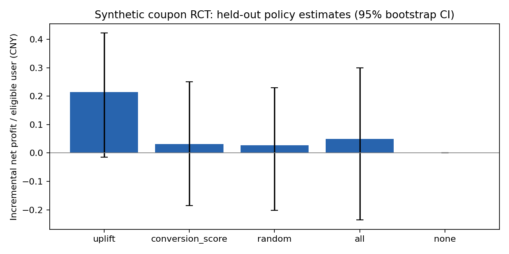

# 电商用户增长与补贴策略评估 — 运行报告

**数据来源：合成数据。没有使用抖音内部数据，没有真实上线或业务收益。**

- 随机种子：42；用户数：60,000；独立测试集：12,000。
- 模拟场景：短视频、直播、商城；控制组不发券，实验组发8元券，购买时核销。
- SRM p-value：0.3823。
- ITT 购买转化差：3.98 个百分点，95% CI [3.53, 4.42]。
- 验证集选择的定向比例：50%；随后冻结策略，在测试集估计收益。
- 归一化 IPW Qini 面积：0.00876（累计增量转化曲线减去随机基线，仅作测试集诊断）。
- Uplift 策略增量净利润/全体合格用户：0.215 元，95% bootstrap CI [-0.014, 0.423]。
- 盈利证据：净利润区间包含或低于零，当前不能认定策略稳定盈利，应扩大验证或调整券额。
- 样本量示例：基线15%、绝对MDE 2个百分点、双侧alpha=.05、power=.8，每组约5,274人。

## 解释

所有定向策略与“不发券”比较。随机策略与转化评分策略使用相同触达比例；购买核销率不同，因此实际支出不同，不能称为等预算实验。全量策略用于参照。ROI 定义为（增量毛利－补贴成本）/补贴成本，不把 GMV 当作利润。

模型为 T-Learner（分别拟合实验组与控制组随机森林），只使用分组前特征；验证集调比例，测试集不参与调参。测试集利用已知随机分组概率进行 IPW 估计，区间来自对固定测试策略逐用户 bootstrap，未覆盖重新训练与调参的不确定性。分层结果仅作探索，不直接声称显著。

人货场分层位于 segments.csv，A/B、CUPED、ROI明细位于 summary.json。公开行为日志如有输入，则单独输出描述性指标，不能与此实验连接成同一批用户。
