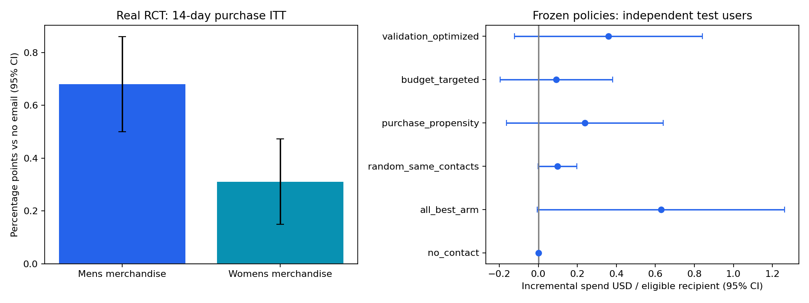

# 存量用户激活：真实三臂随机营销实验

数据：Hillstrom原始64,000名客户，前一年内购买过；随机分配男装邮件、女装邮件、不发邮件，结果观察14天。消费金额为USD。不是抖音数据，也不是发券实验。

## 主要平均效果（公开数据回顾研究）

|营销内容|购买转化增量(pp)|95% CI(pp)|Holm p-value|
|---|---:|---:|---:|
|Mens merchandise|0.681|[0.500, 0.861]|3.0036e-13|
|Womens merchandise|0.311|[0.150, 0.472]|0.00015603|

差值95%区间为单比较区间，Holm校正用于两次主要购买率检验；当前指标选择不代表原实验预注册。

SRM p=0.9037，最大前置特征|SMD|=0.0137。通过审计不等于证明任何数据都随机。全部分配用户进入ITT；访问后购买率仅用于描述路径，不能把访问者当作重新随机的实验人群。

## 有限触达策略

预设最多触达10,000/64,000=15.625%用户。60/20/20分割，训练集38,400人、验证和测试各12,800人；验证集选择模型与内容、冻结后测试。收入T-Learner（Ridge/RF）、训练集5折交叉拟合DR-Learner与自然购买概率基线均实际计算。

受约束候选：dr_learner；实际测试触达15.625%。
相对不触达的增量消费/合格用户：$0.0922，95% CI [-0.1966, 0.3811]。
相对等触达随机基线的**配对差值**：$-0.0060，95% CI [-0.2793, 0.2674]。
区间跨零或低于零，不能认定定向优于等触达随机；采用更复杂模型没有自动形成业务收益。

等触达随机策略使用概率混合，报告期望效果；不是多次随机抽样挑最差基线。DR与HT对照见policies.csv，测试分位校准见cate_calibration.csv。区间不包含重新训练和选择不确定性；稀疏重尾收入、单次历史实验与无新时段外部验证限制结论外推。

## 决策与成本

实测收入与假设成本分开。利润率30%、每触达$0.05是预设情景，并非实际财务数据。优先查看增量收入、盈亏平衡触达成本和economic_sensitivity.csv中的参数区间。未观察真实邮件成本、退款或毛利；不能声称真实补贴ROI提升，也不能据此断言某个券额有效。

后续真实业务：在有成本/核销/退款数据后，预注册按用户稳定分组的内容或券额实验，先验样本量来自真实控制购买率0.573%；MDE 0.3pp、80% power、每比较alpha=.025需每组约15,152人。既有用户激活不能包装为新客拉新。

## 可验证产物

ITT/协变量调整/前置平衡/实验划分/验证选择/策略配对比较/预算与利润率敏感性表均包含实际数值。历史消费是前一年数据，训练集固定系数调整报告实际精度改善；不会称其为实验前14天消费，也不会因改善不显著而删除结果。所有模型输入字段明确排除处理标志及处理后visit/conversion/spend。

