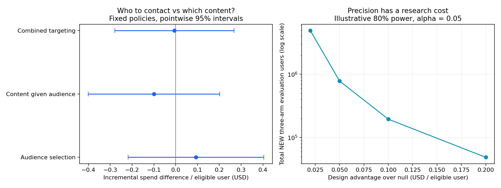

# 营销决策备忘录：平均有效的触达，值得增加定向复杂度吗？

**建议：保留简单策略作为候选基线，先明确额外实施成本和最小值得投入的收入优势，再决定是否资助下一轮验证。当前证据既不能支持模型定向有额外优势，也不能证明它没有商业价值。** 本文是对既有公开实验的回顾性决策诊断，不是新增的未查看测试集，不构成真实投放结果。

Hillstrom是64,000名存量客户的三臂随机邮件实验。全样本中两种邮件相对不触达的14天购买率增量为0.681/0.311个百分点；有限容量定向的评估却只使用冻结的12,800人测试集，其中购买用户124人。平均触达效果与定向额外优势是不同的问题，不能用前者代替后者。

## 1. 三种竞争解释如何区分？

|解释|可见证据|当前判断|
|---|---|---|
|触达没有平均作用|原实验全体购买率ITT与校正检验|两种内容均有正向平均购买率证据；不等于已知毛利或券ROI|
|用户选择有优势，但内容选择抵消了收益|同一冻结定向用户统一内容，再与原策略、同触达随机比较|点估计存在抵消，但各自区间很宽，不能确认这套机制|
|定向优势很小，或样本不足以判断|配对区间与外部业务门槛比较|当前区间不能排除若干有意义的正向优势，也包含损失；没有等效性证据|

既有训练、验证、测试划分及策略全部保留。重建所有旧策略结果，最大点估计误差为0，没有重新挑选模型、种子、容量或内容。

## 2. 拆开“选谁”和“发什么”

同样触达15.625%的测试用户，原验证集选定的统一内容为男装邮件。这里的容量是原研究的明确情景，不是已观测的运营预算。

|配对对比|收入差/合格用户|各自95%区间|
|---|---:|---:|
|沿用定向用户、统一内容 vs 同触达随机、统一内容|+$0.0930|[−$0.2177, $0.4037]|
|原混合内容定向 vs 相同定向用户、统一内容|−$0.0990|[−$0.4004, $0.2024]|
|原混合内容定向 vs 同触达随机、统一内容|−$0.0060|[−$0.2793, $0.2674]|

前两项点估计之和等于第三项，区间端点不能相加。分解按“先沿用原混合内容策略选中的人群，再改变内容”的指定比较顺序进行，不是唯一的机制归因；统一内容的人群也没有重新优化。因此不能据这张表直接上线“统一内容定向”。详见[配对分解](audience_content_decomposition.csv)。

## 3. 什么时候额外建模值得投入？

同触达比例下，邮件触达成本在两策略比较中抵消。若覆盖N名合格用户、贡献率为m、额外实施成本为H，则收入优势必须超过：

`δ_min = H / (N × m)`。

若另有每用户维护成本，将其计入H或相应单位成本。实际成本和贡献率未知，所以这里不给一个虚构的最优ROI。

- 当前95%区间为[−$0.2793, $0.2674]。对于每合格用户$0.02、$0.05、$0.10、$0.20等**示例门槛**，均跨越门槛，现有证据无法决策。
- 若真实外部成本要求优势超过$0.30/人，当前区间上界低于该门槛，可排除达到这个较高门槛的优势。$0.30不是根据本数据替业务设定的最低收益要求。
- “未显著”不等于“模型无用”；低成本简单方案只是当前应保留的比较基线，不是本测试已证明的最优策略。

对各固定策略还计算了`c/m`的盈亏平衡范围，单位是每次触达所需的增量收入。点估计显示同触达随机约$0.629、原定向约$0.590，但其测试区间下界均低于0，不能把点估计当安全支出上限。不同容量的策略不能直接替代同一预算下的方案。详见[运营门槛](operating_thresholds.csv)、[固定策略成本曲线数据](cost_ratio_sensitivity.csv)。这些曲线没有用于重选测试集最佳策略。

## 4. 还需要多少证据，值得继续研究吗？

用本次配对得分方差248.91作为pilot，在**新的、相同三臂随机采集、相同冻结策略与DR估计器**下，按双侧α=0.05、80%功效的正态近似规划：

|未来设计问题|假定真实收入优势|新的独立评估总人数|
|---|---:|---:|
|检出相对零的优势|$0.05/人|约78.1万|
|检出相对零的优势|$0.10/人|约19.5万|
|检出相对零的优势|$0.20/人|约4.9万|
|证明超过$0.02/人门槛|$0.05/人|约217.1万|

这些是设计情景，假定真实效果不来自当前−$0.006的点估计；不是“事后功效”，也不是已经收集的样本量。N是总评估人数，不能再乘三或称为每组人数。若未来结果方差翻倍，所需人数近似翻倍；0.5/1/2倍方差是环境敏感性，不是方差置信区间。重尾、策略重训或人群漂移会破坏近似。

**更直接的下一轮可以随机分配两套冻结策略，作为两策略A/B实验。** 这种设计的方差不同，不能沿用上表人数；需要先取得两策略结果方差、成本与护栏的pilot。只有当预期验证价值和可获得样本支持继续研究，才投入更复杂模型。完整情景见[样本量表](future_evaluation_size.csv)。

## 5. 交给业务的下一步

|需要谁提供信息|需要的信息|用于什么决定|
|---|---|---|
|运营/财务|可触达规模、增量触达成本、贡献率、模型维护成本|确定δ_min，判断已有区间能否回答业务问题|
|产品/算法|冻结的准入、评分、内容与频控策略；实施复杂度|固定两策略比较对象，避免每轮同时更换多项动作|
|数据/实验|相同人群的结果方差、退款与成本日志、随机分配和干扰检查|选择三臂OPE或直接策略A/B，并重新计算功效|

如果成本门槛低且所需样本可获得，可以安排新的独立验证；如果门槛高于当前可支持范围或验证成本过高，应优先维持简单方案并收集成本信息。本文不把一个不显著的点估计写成确定的商业胜负。

复现：先完成`python -m campaign.run`，再运行`python -m campaign.decision`。完整运行也由`python run_project.py`编排。
