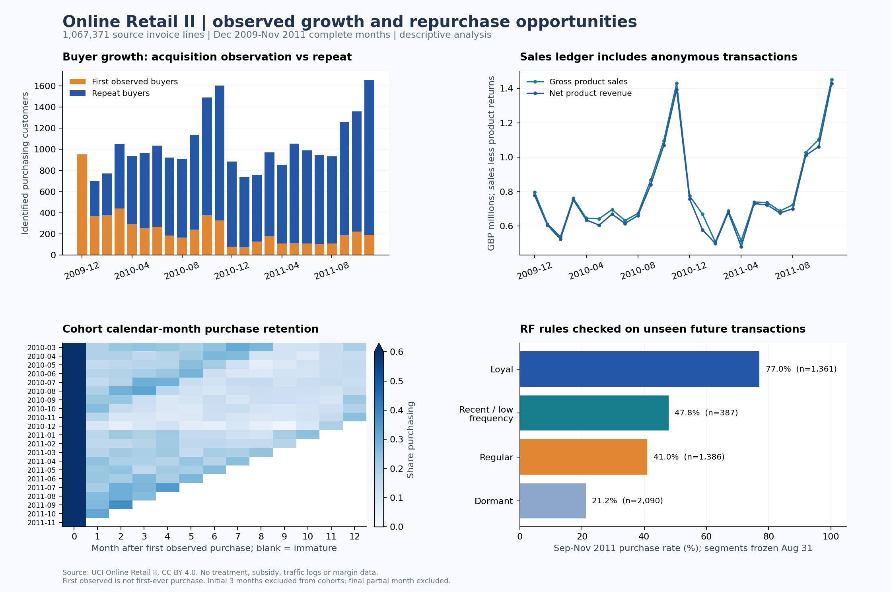

# 真实交易分析：增长从哪里来、哪些复购机会值得实验

本报告由 `python -m retail` 自动生成，源数据为英国线上礼品零售商交易，币种 GBP。原始数据属于真实交易记录；本报告不是抖音业务结论，也没有把交易观察关联解释成补贴因果效应。



来源：[UCI Online Retail II](https://archive.ics.uci.edu/dataset/502/online+retail+ii)，Chen, D. (2012)，DOI [10.24432/C5CG6D](https://doi.org/10.24432/C5CG6D)，CC BY 4.0。

实际处理 **1,067,371** 条发票行，2009-12-01 至 2011-12-09。最后一个月 2011-12 不完整，月度增长和月度留存均剔除该月；日级复购成熟度仍使用截至观测末日的记录。

## 口径与审计

- 疑似完全重复行 34,335 条。按发票、SKU、描述、数量、日期、价格、客户、国家去重，不将来源工作表作为业务键。源文件无唯一发票行 ID，因此重复不必然是错误；保留去重前后金额敏感性。
- 原始客户 ID 缺失 243,007 条；匿名交易参与商品销售/退货金额，排除买家数、RF 分群、复购分母。
- 清洗后 1,027,017 条有效价格/数量行，1,003,214 条商品购买行、17,914 条商品退货/贷项行；非商品代码 5,889 条。
- 商品 SKU 规则为五位数字加可选字母后缀。运费、折扣、银行费用、调整等独立代码不计入商品金额；不符合 SKU 规则的其余代码标为未映射，而不直接推断为费用。完整描述与代码金额敏感性见 `audit.json`；零价、负价、零数量及必需字段缺失另列。
- 零价行可能是赠品或数据调整，因付费购买口径而排除，不直接认定为错误。这些审计标记可重叠，不能简单相加当成互斥清洗漏斗。
- 购买订单为 `(customer_id, invoice)` 聚合的正向商品发票；退货不并入购买订单频次。取消标记或负数量归入退货账簿，无法判断实际退款原因或匹配原订单。
- 1 条 C 前缀且数量为正的记录，原始 qty×price 合计 £373.57；本项目按取消账簿符号规则转为负金额（口径假设），相对原始符号的全代码净额变化为 £-747.14，其中商品账簿变化为 £0.00。
- 观察到 5,852 位可识别买家、39,516 个购买发票（含匿名），商品正向销售 £19,642,692、退货金额 £716,426、净商品金额 £18,926,266。
- 不去重的净商品金额为 £19,382,476；纳入所有有效非商品代码的净金额为 £19,013,463。这些是收入口径，不是利润、增量 GMV 或 ROI。

## 可识别用户增长拆解

月购买金额 = 活跃买家 × 人均订单 × 单均金额。活跃买家 = 首次观察买家 + 连续月购买买家 + 回流买家。首次观察不等于平台新增注册用户；没有曝光、访问日志，不能计算完整获客/支付转化漏斗。

| 同月比较 | 2010-11 | 2011-11 | 同比 |
|---|---:|---:|---:|
| 活跃买家 | 1,606 | 1,660 | +3.4% |
| 首次观察买家 | 326 | 191 | -41.4% |
| 复购买家 | 1,280 | 1,469 | +14.8% |
| 人均订单 | 1.60 | 1.59 | -0.5% |
| 单均金额 | £450 | £430 | -4.4% |
| 可识别购买金额 | £1,155,978 | £1,136,534 | -1.7% |

逐月对数变化精确拆解见 `monthly_decomposition.csv`。同比减少旺季季节性的干扰，但两年样本不足以识别因果增长驱动。

## 复购机会及成熟度

剔除观测初始三个月的首次观察 cohort，减轻左截断；仍无法确认用户此前从未购买。复购须发生在首次购买之后的另一个日历日，避免同日拆单。各窗口仅使用完整成熟 cohort：

| 窗口 | 成熟首次观察买家 | 复购买家 | 累计复购率 |
|---|---:|---:|---:|
| 30 天 | 3,939 | 676 | 17.2% |
| 60 天 | 3,718 | 1,139 | 30.6% |
| 90 天 | 3,530 | 1,368 | 38.8% |

三个窗口成熟 cohort 集合不同，不能直接把表中差值解释为同一批用户的新增复购率。逐 cohort 结果及成熟标记见 `repurchase_by_cohort.csv`。

固定使用已完整观测 90 天的 cohort，比较同一分母的累计复购：
- 30 天：16.4% （579/3,530）。
- 60 天：29.8% （1,053/3,530）。
- 90 天：38.8% （1,368/3,530）。

月留存定义为 cohort 在第 k 个日历月是否购买，允许跳月后回流，不是连续生存概率：
- M1：20.7% （815/3,939，仅该偏移完整可观测 cohort）。
- M3：19.1% （675/3,530，仅该偏移完整可观测 cohort）。
- M6：17.4% （559/3,214，仅该偏移完整可观测 cohort）。

## 人货场刻画与时间外验证

人：2011-08-31 以前数据形成 RF 规则分群；2011-09 至 11 是未参与分群的未来评价窗口。频次与最近购买各分五档，按明确规则形成分群；历史金额未参与标签，用来刻画客户价值。相同值用 customer_id 稳定排序，分位边界存在人为划分，须做阈值敏感性；它是可解释基线，不是因果响应模型。

| 分群 | 历史客户 | 历史人均购买金额 | 未来购买率 | 未来人均购买金额 |
|---|---:|---:|---:|---:|
| loyal | 1,361 | £7,042 | 77.0% | £1,454 |
| recent_low_frequency | 387 | £505 | 47.8% | £389 |
| regular | 1,386 | £1,426 | 41.0% | £259 |
| dormant | 2,090 | £824 | 21.2% | £112 |

货：按单品价格带比较购买人数、件数、金额，见 `price_band_metrics.csv`。买家和同一 SKU 可能跨价格带，人数/商品数不能跨组求和；没有商品类目，不编造品牌/品类。

场：按国家市场划分，见 `country_metrics.csv`。该数据只有线上零售交易，没有短视频/直播/商城来源，因此国家是市场维度，不是流量场景或渠道归因。

已识别买家前 1%（59 人）贡献 32.1% 正向商品购买金额。来源说明中包含批发客户，金额分布受大户影响；业务建议需要普通买家/批发客分层实验。

## 建议进入实验的业务假设

1. 最近购买但低频客户存在二购培育空间。先做商品推荐/触达与无触达对照，主指标为预先定义 30 天复购率，次指标为人均净商品金额；对产品购买/退货共同观测。
2. 高历史价值客户本来就有较高未来购买率，不能依据购买概率直接发补贴。先做客户级随机 holdout 识别净增量，避免把原本就会买的客户收入记作补贴收益。
3. 沉睡客户按历史价值与最近购买分层，分别估计触达效果；该交易集没有触达、补贴和成本字段，不能用这里的 RF 分群表报告补贴 ROI。随机干预分析在独立真实 RCT 模块完成。

## 复现与检查

```powershell
python -m retail
python -m unittest tests.test_retail -v
```

默认下载使用固定 GitHub commit 的 UCI 数据镜像，以 8 个互不重叠字节块校验 ETag/ContentRange、完整文件长度、XLSX CRC 及项目已审计 SHA256。该 SHA256 是本项目输入指纹，不是 UCI 官方公布的校验和。已有匹配缓存及 `--reuse-db` 会复用本地数据。

如手动从 UCI 获取官方文件，可用 `python -m retail --xlsx <path> --source-url <actual_download_url>`；流水线仍核对两工作表结构和总行数，记录实际指纹。

原始 XLSX/ZIP、DuckDB 库和全量 Parquet 放在 gitignored `data/`；此目录中 CSV/audit 是全量数据派生输出。流水线使用只读 XLSX 行迭代、5 万行 CSV 批量入库、256 MB DuckDB 内存限制；不把百万行数据放入 pandas。

`checks.json` 自动检查买家分类恒等式、收入乘法恒等式、商品销售/退货账簿、匿名/已识别金额衔接、逐月对数拆解及 cohort 分母约束。边界测试覆盖匿名客户、退货、同日拆单、右删失、去重跨工作表和价格无效值。

Hive 使用确定性排序的 5 万行 CSV 运输样本；仅描述字段去除换行，分析 Parquet 不修改描述。真实 Hive 执行证据由仓库 CI 报告提供，不能把 DuckDB 执行说成 Hive 集群运行。
