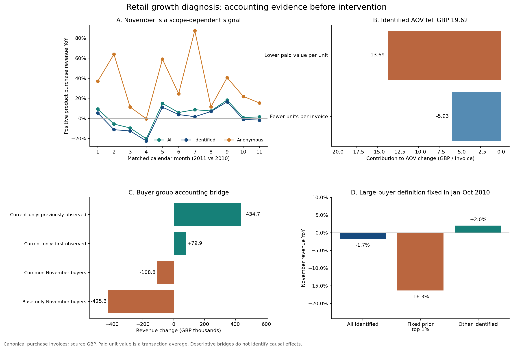

# 经营诊断备忘录：这次“用户价值下降”值得扩大补贴吗？

**建议：现有账簿不支持把11月异常定义为全体客户普遍恶化，并据此扩大普惠补贴。优先核对客户识别范围、高历史购买额客户的大订单与商品购买组合；海外未进入固定高购买额名单的客户另列调查。** 这是基于公开历史数据的研究建议，未实施营销或修改实际预算。

诊断对象是UCI Online Retail II中2011年11月对2010年11月的同月比较。初始信号为可识别买家增加3.36%，对应的商品正向购买金额却减少1.68%。以下先检验这个问题的范围，再比较竞争解释。金额为GBP；净商品金额指本期正向商品金额减本期退货金额，未与原始购买逐单匹配，不是利润。

## 1. 第一条被修正的判断：整体经营也在下降

|账簿范围|2010年11月|2011年11月|同比|
|---|---:|---:|---:|
|有客户ID的商品购买金额|£1,155,978|£1,136,534|−1.68%|
|无客户ID的商品购买金额|£273,575|£315,579|+15.35%|
|全体商品正向金额|£1,429,553|£1,452,113|+1.58%|
|全体退货抵减后商品金额|£1,394,454|£1,427,121|+2.34%|

金额桥接为：`已识别 −£19,444 + 匿名 £42,004 = 全体正向 £22,559`；退货抵减额减少约£10,108，使净商品金额增加约£32,667。这里保留四舍五入误差，精确分录见[账簿表](ledger_sensitivity_yoy.csv)。

**经营范围的判断发生反转，但“客户ID丢失造成迁移”尚未被证实。** 匿名记录没有可连接的客户键。不能把两期匿名交易当作同一批客户，也不能据其增长虚构新增买家数。需要身份写入与订单来源日志，才能区分真实游客购买、渠道结构变化和采集问题。

## 2. 第二条被削弱的判断：普通客户普遍变差

先用2010年1—10月已知购买金额定义前1%客户，冻结38人的名单，再观察两个11月。名单没有使用待比较月份的表现；最低入选历史购买额为£15,901.56。“高历史购买额”不自动等于批发商。

|固定客户范围|2010年11月|2011年11月|金额变化|
|---|---:|---:|---:|
|38名高历史购买额客户中的当期买家|£234,181|£195,956|−£38,225（−16.32%）|
|其余可识别客户|£921,797|£940,578|+£18,781（+2.04%）|
|全体可识别客户|£1,155,978|£1,136,534|−£19,444（−1.68%）|

少数固定客户的下降超过全部已识别客户的净下降，其余客户形成抵消。这个结果支持优先查大客户采购周期、大订单和商品供应记录。它不证明这些客户“流失”，也不证明一张优惠券能挽回对应金额。

国家分层保留了一个需要继续调查的信号：剔除上述固定高购买额名单后，英国客户金额增长3.04%，其他国家客户仍下降4.70%。后者的买家数增长约30.77%、每单件数下降约33.41%，应先调查订单篮子、运费/起订量、国家与客户组合，不能用全店统一解释。详见[大客户与国家敏感性](large_buyer_sensitivity_yoy.csv)。

另一种客户集合桥接也提供了调查对象：687名两期都购买的客户金额减少£108,787；919名仅基期11月购买客户对应基期金额£425,252；191名当前月首次观测客户贡献£79,903；782名当前月购买、基期同月未买但历史已观测客户贡献£434,691。这四项精确对账，但不能把“同期未购买”称为永久流失，把“首次观测”称为平台新增，或把缺口金额称为可追回收入。见[客户桥接](customer_bridge.csv)。

## 3. 第三条被削弱的判断：成交均价降低，说明普遍降价

可识别订单的平均金额由£449.80降至£430.18，减少£19.62。对称分解得到：每单件数贡献−£5.93，成交单位金额贡献−£13.69。两项加总，而不是任选替换顺序。

成交单位金额由£1.77230降至£1.71800，变化−£0.05430/件。进一步对账：

|组成|对单位金额变化的贡献|
|---|---:|
|共同SKU内部成交单位金额变化|−£0.00785/件|
|共同SKU的件数权重变化|−£0.08380/件|
|共同集合份额与仅一期成交SKU的联合变化|+£0.03734/件|
|合计|−£0.05430/件|

**该分解更符合购买组合下移的解释，不能据此断言所有商品都需要调价或补贴。** 共同SKU覆盖两期件数的90.98%和70.36%；完整五项分录与各SKU贡献见[分解结果](paid_unit_value_decomposition.json)和[SKU贡献表](identified_sku_common_contributions.csv)。仅一期成交不等于上新、下架或缺货。

按中心化的商品组合贡献选出具体调查例子，均为两个11月的可识别客户购买：

|商品|购买件数变化|成交金额/件变化|应核查什么|
|---|---:|---:|---|
|22423：三层蛋糕架|1,938→942|£11.43→£11.72|高于平均单位金额的商品购买权重下降；查大订单构成、采购周期与库存记录，不能直接认定缺货|
|22578：木星形圣诞装饰|891→4,980|£0.850→£0.296|件数结构和同SKU单位金额均下移；查批量折扣、客户构成与促销日志|
|16014：中式小剪刀|16→3,606|£0.420→£0.323|低单位金额商品件数权重显著增加；查是否集中在少数订单或特定国家|

这些例子用于形成可核查的问题，不代表三个SKU解释全部降幅。中心化贡献以共同SKU平均单位金额为参照，避免把低价商品份额上升误写成抬高平均价格。

相同客户×SKU匹配中的内部单位金额贡献为正，但只有4,723个共同购买对，覆盖两期件数约16.01%和14.13%。这个低覆盖样本只能作敏感性检查，不能外推为所有客户同客同品涨价。成交均价还受批量折扣、国家与购买条件影响；目前未识别挂牌价变化或价格弹性。

## 4. 这是不是长期趋势？

|可比窗口|可识别客户商品金额同比|
|---|---:|
|1—11月累计|+0.08%|
|第三季度|+9.30%|
|9—11月|+3.52%|
|10—11月|−1.32%|
|11月|−1.68%|

1—11月全体商品金额增长3.01%，可识别买家增长0.99%。11月不能代表全年普遍衰退，最近两月的局部信号仍值得跟进。2011年12月不完整，因此没有宣称完整Q4结果。累计客户重新去重，两个历史年份不能提供长期外推保证。详见[全部11个月](monthly_yoy.csv)、[累计窗口](pooled_yoy.csv)。

保留完全重复记录时，可识别金额同比为−1.70%，去重后为−1.68%，本例方向不由去重决定。纳入同一已识别范围退货后同比为−0.71%；退货口径缩小降幅，但未使该子账簿转正。数据口径与高购买额敏感性均保留，未挑选最有利的版本。

## 5. 推荐动作、责任与改变判断的条件

|优先级与协作对象|建议动作|需要补充的证据|什么证据会改变当前建议|
|---|---|---|---|
|P0：数据/研发|核对订单范围与客户ID覆盖，拆登录、游客、来源系统|事件日志、订单来源、ID映射成功率与变更记录|若映射异常解释主要差额，先修数据；若无异常，再分析真实匿名购买结构|
|P1：客户/商品运营|复核固定高购买额客户的大订单、采购周期和供应约束|大客户身份、询单/取消原因、库存与缺货记录|若只是采购时间移动，跟踪跨月；若持续客户需求或供给受损，再设计对应修复动作|
|P1：海外运营/产品|调查固定名单外海外订单篮子下降|国家、运费、起订量、商品可得性与购物行为|若特定规则调整先于篮子下降，形成明确假设并安排小范围随机验证|
|P2：增长/实验|获得机制证据后再评估优惠、运费或触达动作|目标人群、成本、可得商品与随机分配日志|只有增量净贡献和护栏满足预先业务门槛，才支持扩大投入|

这份分析交付的是**问题定义、调查优先级与验证条件**。没有把机械归因写成因果证明，也没有把历史差额包装成预算收益。独立营销实验对“定向是否值得投入”的分析见[另一份决策备忘录](../campaign_decision/DECISION_MEMO.md)，它不能替代本零售人群的实验。

复现：已有完整交易数据库时运行`python -m retail.diagnose`。分解方法及局限见[TECHNICAL.md](TECHNICAL.md)，金额恒等式见[checks.json](checks.json)。
